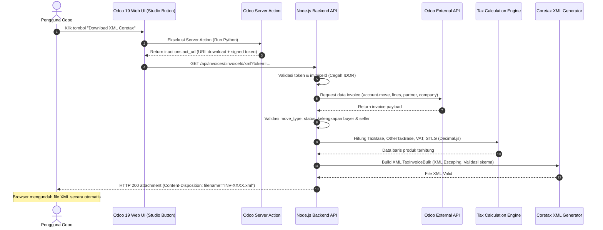

# Rencana Implementasi & Arsitektur Integrasi Odoo 19 Invoice ke XML Coretax

Dokumen ini memuat analisis kelayakan, arsitektur sistem, pemetaan data (field mapping), spesifikasi perhitungan pajak, dan panduan eksekusi teknis untuk integrasi ekspor faktur pajak Coretax dari Odoo 19 Online menggunakan Node.js.

---

## 1. Analisis Kelayakan & Keterbatasan Lingkungan (Feasibility Analysis)

### 1.1 Lingkungan Odoo 19 Online (SaaS)
- **Karakteristik**: Berbeda dengan Odoo On-Premise/Self-Hosted, Odoo Online tidak memberikan akses command line/shell, filesystem OS, atau kemampuan menginstal custom Python module secara sembarangan.
- **Server Action Sandbox (`safe_eval`)**:
  - Python interpreter pada Server Action berjalan dengan pembatasan ketat (`safe_eval`).
  - Tidak diperkenankan melakukan `import requests`, `import urllib`, `import socket`, dll.
  - Namun, objek `env`, `record`, `records`, `time`, `datetime`, dan return dictionary action standar (`ir.actions.*`) didukung penuh.
- **Mekanisme Direct Download 1-Klik**:
  - Server Action Odoo mendukung pengembalian action bertipe `ir.actions.act_url`.
  - Ketika tombol di Odoo Studio ditekan, Server Action mengembalikan:
    ```python
    action = {
        'type': 'ir.actions.act_url',
        'url': f'https://api-backend.yourdomain.com/api/invoices/{record.id}/xml?token={auth_token}',
        'target': 'self',
    }
    ```
  - Browser Odoo secara otomatis mengarahkan request ke URL tersebut dan langsung memicu unduhan file binary (`TaxInvoiceBulk.xml`) tanpa meninggalkan halaman aktif.
- **Alternatif/Fallback**:
  - Jika diperlukan penyimpanan riwayat file di dalam Odoo, backend dapat menggunakan External API Odoo untuk membuat record pada model `ir.attachment` yang terhubung dengan `res_model='account.move'` dan `res_id=invoice_id`.

### 1.2 Odoo External API
- Odoo 19 mendukung External JSON-2 API / JSON-RPC / XML-RPC menggunakan API Key pengguna.
- Backend Node.js akan bertindak sebagai client yang melakukan autentikasi aman menggunakan environment variables (`ODOO_URL`, `ODOO_DB`, `ODOO_USERNAME`, `ODOO_API_KEY`).
- Hanya query invoice terpilih berdasarkan ID (`account.move.browse` atau `search_read`) dengan filter `move_type == 'out_invoice'`.

---

## 2. Arsitektur Sistem & Alur Data



---

## 3. Pemetaan Data (Field Mapping Matrix)

### 3.1 Header Faktur Pajak (`TaxInvoice`)

| XML Tag | Sumber Data Odoo | Model & Technical Field | Aturan Transformasi & Validasi |
| :--- | :--- | :--- | :--- |
| `TIN` (Root) | Perusahaan Penerbit (ISE) | `res.company` -> `vat` | Bersihkan format; 15/16 digit angka NPWP Seller. |
| `TaxInvoiceDate` | Tanggal Faktur | `account.move.invoice_date` | Format wajib `YYYY-MM-DD`. Wajib terisi. |
| `TaxInvoiceOpt` | Konstanta | Nilai tetap: `Normal` | Nilai default Coretax untuk faktur normal. |
| `TrxCode` | Jenis Transaksi | Konstanta `04` (atau sesuai konfigurasi) | Sesuai jenis transaksi PPN Coretax. |
| `AddInfo` | Informasi Tambahan | Empty Element `<AddInfo/>` | Elemen kosong dipertahankan. |
| `CustomDoc` | Dokumen Pendukung | Empty Element `<CustomDoc/>` | Elemen kosong dipertahankan. |
| `RefDesc` | Referensi Pelanggan | `account.move.ref` | Nomor PO / referensi customer, di-escape XML. |
| `FacilityStamp` | Fasilitas Perpajakan | Empty Element `<FacilityStamp/>` | Elemen kosong dipertahankan. |
| `SellerIDTKU` | Identitas TKU Penjual | `res.company.vat` (+ cabang) | Format 16 digit TKU Coretax / NPWP 16 digit. |

### 3.2 Identitas Pembeli (`Buyer Information`)

| XML Tag | Sumber Data Odoo | Model & Technical Field | Aturan Transformasi & Validasi |
| :--- | :--- | :--- | :--- |
| `BuyerTin` | NPWP Pelanggan | `res.partner.vat` | Normalisasi digit angka (15/16 digit). Jika kosong/NIK gunakan 0000000000000000 atau format NIK. |
| `BuyerDocument` | Jenis Dokumen | Evaluasi dinamis | `TIN` jika ber-NPWP, `NATIONAL_ID` jika NIK, `PASSPORT` jika WNA. |
| `BuyerCountry` | Negara Pelanggan | `res.partner.country_id.code` | Kode negara ISO-3 (misal: `IND` untuk Indonesia). |
| `BuyerDocumentNumber` | Nomor Dokumen Identitas | `res.partner.vat` / field NIK | Terisi jika BuyerDocument bukan TIN. |
| `BuyerName` | Nama Pelanggan | `res.partner.name` | XML Escaping wajib untuk karakter `&`, `<`, `>`. |
| `BuyerAdress` | Alamat Pelanggan | `res.partner.street` + `street2` + `city` | **PENTING**: Tag harus dieja `BuyerAdress` (1 huruf d). |
| `BuyerEmail` | Email Pelanggan | `res.partner.email` | Validasi format email sederhana. |
| `BuyerIDTKU` | Identitas TKU Pembeli | Hasil pembentukan dari NPWP | 16 digit NPWP/TKU sesuai regulasi Coretax. |

### 3.3 Detail Barang/Jasa (`ListOfGoodService` -> `GoodService`)

| XML Tag | Sumber Data Odoo | Model & Technical Field | Aturan Transformasi & Perhitungan |
| :--- | :--- | :--- | :--- |
| `Opt` | Tipe Barang / Jasa | Konfigurasi line / default | `A` = Goods (Barang), `B` = Service (Jasa). |
| `Code` | Kode Barang Coretax | Konstanta `000000` | Sesuai template referensi. |
| `Name` | Nama Produk / Jasa | `account.move.line.name` | Deskripsi baris invoice Odoo (XML escaped). |
| `Unit` | Satuan Barang | `product_uom_id.name` / `Unit` | Default: `Unit` (atau kode satuan DJP). |
| `Price` | Harga Satuan | `account.move.line.price_unit` | Angka desimal/bulat tanpa pemisah ribuan. |
| `Qty` | Kuantitas | `account.move.line.quantity` | Angka tanpa pemisah ribuan. |
| `TotalDiscount` | Nilai Diskon | Dihitung dari `discount` % | `Price * Qty * discount / 100` |
| `TaxBase` | Dasar Pengenaan Pajak | Dihitung oleh Tax Engine | Berdasarkan formula yang dikonfigurasi. |
| `OtherTaxBase` | DPP Nilai Lain | Dihitung oleh Tax Engine | Berdasarkan formula yang dikonfigurasi. |
| `VATRate` | Tarif PPN | Konfigurasi (`12` atau `11`) | Nilai persentase (12%). |
| `VAT` | Nilai PPN | Dihitung oleh Tax Engine | `OtherTaxBase * VATRate / 100` |
| `STLGRate` | Tarif PPnBM / STLG | Konfigurasi (`0` atau diskon) | Sesuai konfigurasi rule. |
| `STLG` | Nilai PPnBM / STLG | Dihitung oleh Tax Engine | `TaxBase * STLGRate / 100` |

---

## 4. Spesifikasi Tax Calculation Engine

Untuk memenuhi persyaratan bahwa formula perhitungan harus **dapat dikonfigurasi (configurable)** dan **presisi tinggi**:

### Formula A (Spesifikasi Sesuai Prompt):
- $\text{GrossTotal} = \text{Price} \times \text{Qty}$
- $\text{TotalDiscount} = \text{GrossTotal} \times \frac{\text{DiscountPct}}{100}$
- $\text{TaxBase} = \frac{11}{12} \times \text{Price}$ *(atau per gross jika disesuaikan)*
- $\text{OtherTaxBase} = \frac{11}{12} \times \text{TaxBase}$
- $\text{VAT} = \text{OtherTaxBase} \times \frac{\text{VATRate}}{100}$
- $\text{STLG} = \text{TaxBase} \times \frac{\text{STLGRate}}{100}$

### Formula B (Spesifikasi Standar DJP Coretax):
- $\text{GrossTotal} = \text{Price} \times \text{Qty}$
- $\text{TotalDiscount} = \text{GrossTotal} \times \frac{\text{DiscountPct}}{100}$
- $\text{TaxBase} = \text{GrossTotal} - \text{TotalDiscount}$
- $\text{OtherTaxBase} = \text{TaxBase}$ *(kecuali transaksi DPP Nilai Lain tertentu)*
- $\text{VAT} = \text{OtherTaxBase} \times \frac{\text{VATRate}}{100}$
- $\text{STLG} = 0$ *(kecuali barang kena PPnBM)*

**Implementasi Teknis**:
Menggunakan modul strategi perhitungan pajak (`tax-strategies/`) dengan library `decimal.js`, sehingga pembulatan (`ROUND_HALF_UP`) dan presisi desimal terjamin 100%.

---

## 5. Struktur Modul & Proyek Node.js

Struktur folder mengadopsi standar modular yang ditentukan:

```text
odoo-xml/
├── src/
│   ├── modules/
│   │   └── invoice-export/
│   │       ├── invoice-export.routes.js
│   │       ├── invoice-export.controller.js
│   │       ├── invoice-export.service.js
│   │       ├── invoice-export.validator.js
│   │       ├── invoice-export.mapper.js
│   │       └── invoice-export.test.js
│   │
│   ├── integrations/
│   │   └── odoo/
│   │       ├── odoo.client.js
│   │       └── odoo.repository.js
│   │
│   ├── xml/
│   │   ├── coretax.generator.js
│   │   ├── coretax.validator.js
│   │   └── coretax.mapper.js
│   │
│   ├── tax-engine/
│   │   ├── tax.calculator.js
│   │   └── tax.strategies.js
│   │
│   ├── config/
│   │   ├── app.config.js
│   │   └── odoo.config.js
│   │
│   ├── utils/
│   │   ├── npwp.utils.js
│   │   ├── xml.utils.js
│   │   └── security.utils.js
│   │
│   └── app.js
│
├── tests/
│   ├── unit/
│   └── fixtures/
│       └── TaxInvoiceTemplate.xml
│
├── .env.example
├── package.json
└── README.md
```

---

## 6. Tahapan Eksekusi Teknis

1. **Inisialisasi Project**: Generate `package.json`, install dependencies (`express`, `decimal.js`, `xml2js`, `fast-xml-parser`, `dotenv`, `cors`, `zod`, `jest` / native runner).
2. **Pembangunan Utils & Normalisasi**: NPWP Normalizer (15 ke 16 digit), XML Escaper, Token Signature Security.
3. **Pembangunan Tax Engine**: Engine kalkulasi multi-strategi berbasis `decimal.js`.
4. **Pembangunan XML Generator**: Generator template XML Coretax yang ketat terhadap whitespace, casing (`BuyerAdress`), dan urutan elemen.
5. **Pembangunan Odoo API Client**: Client interaksi Odoo 19 (JSON-RPC/External API) dengan query selektif model `account.move`, `account.move.line`, `res.partner`, `res.company`.
6. **Pembangunan Controller & Routing Express**: Endpoint `GET /api/invoices/:invoiceId/xml` dengan stream file attachment.
7. **Pengujian Menyeluruh (Automated Testing)**: 17 skenario test case (diskon, multi lines, karakter khusus, zero-rounding, validasi buyer).
8. **Dokumentasi Odoo Studio & Deployment**: Panduan integrasi Server Action di Odoo Studio dan konfigurasi server produksi.

